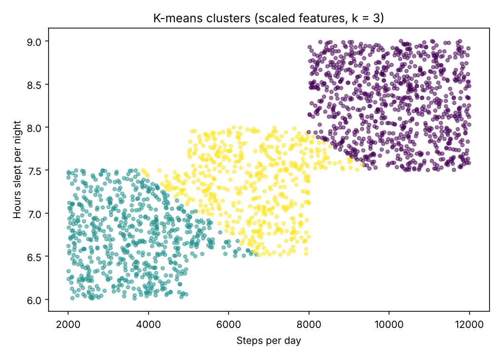

# AI Coursework

Smaller artificial-intelligence projects from CMPG313 Artificial Intelligence (NWU, 2025), tidied up and in places improved. Larger AI projects have their own repos: [Morabaraba Q-learning agent](https://github.com/Waynemusawakhe/morabaraba_ai).

| Folder | Project | Techniques |
|---|---|---|
| [`kmeans-fitness-clustering`](kmeans-fitness-clustering) | Segmenting fitness-tracker users by steps and sleep | Synthetic data generation, feature scaling, K-means, elbow method, silhouette score |
| [`fol-symptom-chatbot`](fol-symptom-chatbot) | Symptom checker that infers conditions with a logic rule | Knowledge base, first-order-logic style inference, unit tests |
| [`sasl-sign-classifier`](sasl-sign-classifier) | Recognising South African Sign Language letters from hand images | Image data collection, transfer learning with Teachable Machine |

## K-means fitness clustering

```bash
pip install numpy matplotlib scikit-learn
python kmeans-fitness-clustering/clustering.py
```

Three groups of users (active, moderate, inactive) are generated and then clustered. Improvements over the original assignment:

- **Features are scaled first.** Steps run into thousands while sleep is single digits, so unscaled K-means is driven almost entirely by steps.
- **k is checked rather than assumed.** The silhouette score is highest at k = 2 (0.58), not 3 (0.45), because the moderate group overlaps both neighbours. Real data rarely falls into the neat groups you expect.
- **A note on correlation:** the sleep–steps relationship in the results comes from how the synthetic groups were generated, not from a real-world finding.



## FOL symptom chatbot

```bash
python fol-symptom-chatbot/chatbot.py
python -m pytest fol-symptom-chatbot
```

Rule: for every condition D, if every symptom of D is in the user's input, then D is a possible match. The design is transparent: you can always see which rule fired. It is also brittle, since a missing or misspelt symptom means no match. A next step would be partial matching with a confidence score. Educational only, not medical advice.
